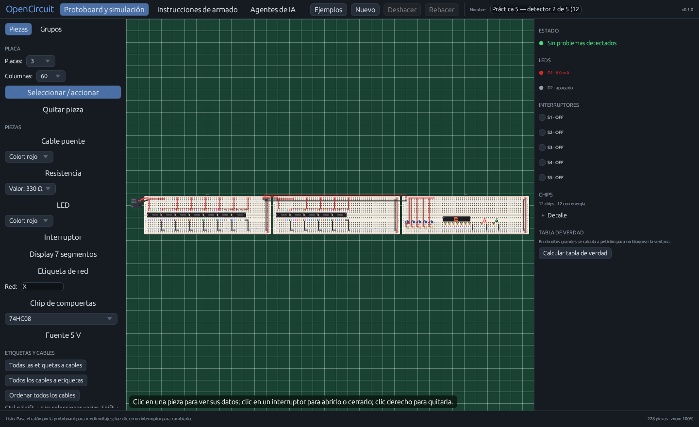
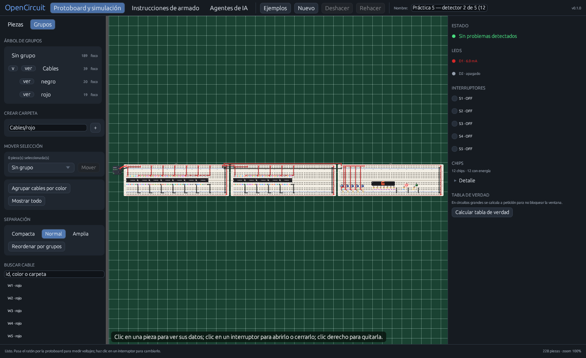
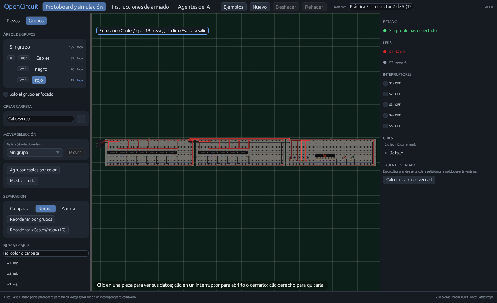
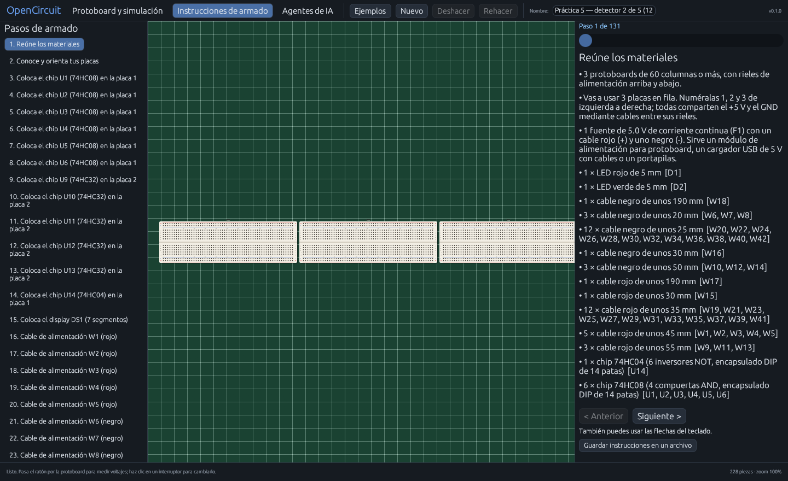

# OpenCircuit

**Simulador de circuitos sobre protoboard** con componentes físicos, cables, compuertas 74HC, display de 7 segmentos y guía de armado paso a paso. Incluye integración MCP para que agentes de IA armen y editen circuitos.

[](https://github.com/Daniel-Gibran/opencircuit-sim/actions/workflows/ci.yml)
[](LICENSE)


> OpenCircuit is a native breadboard circuit simulator with physical components, step-by-step assembly instructions and MCP support for AI agents.



## Características

- Protoboard de 1 a 3 placas, 30 o 60 columnas, con rieles de alimentación.
- Fuente de 5 V, resistencias, LEDs, interruptores, display de 7 segmentos, cables y etiquetas de red.
- Chips 74HC08 (AND), 74HC32 (OR) y 74HC04 (NOT), con alias 7408/7432/7404.
- Simulación nodal: voltajes, corriente de LEDs, display y tabla de verdad.
- Trazado ortogonal de cables que esquiva piezas y respeta los pasillos.
- Grupos de cables: crear carpetas, mover piezas, ocultar, enfocar, buscar y reordenar con distinta separación.
- Instrucciones de armado paso a paso y exportación a Markdown.
- Deshacer, rehacer, selección múltiple y atajos de teclado.
- Integración MCP para Claude Desktop, Claude Code, Cursor y otros agentes.
- Práctica 5 incluida: detector 2 de 5 con 3 placas, 12 CI, display, LEDs y 32 combinaciones.

## Capturas

| Protoboard | Grupos de cables |
|---|---|
|  |  |

| Enfoque de un grupo | Instrucciones de armado |
|---|---|
|  |  |

## Requisitos

- Rust stable (probado con la versión estable actual).
- Linux: dependencias de egui/winit (X11, Wayland y OpenGL).
- macOS: `xcode-select --install`.
- Windows: Visual Studio Build Tools con la carga de trabajo de C++.

En Ubuntu/Debian:

```bash
sudo apt install build-essential pkg-config \
  libxkbcommon-dev libwayland-dev libx11-dev \
  libxcb-render0-dev libxcb-shape0-dev libxcb-xfixes0-dev \
  libxkbcommon-x11-dev libgl1-mesa-dev \
  libxrandr-dev libxi-dev libxcursor-dev libxinerama-dev
```

En Fedora:

```bash
sudo dnf install gcc pkg-config libxkbcommon-devel wayland-devel \
  libX11-devel libxcb-devel mesa-libGL-devel \
  libXrandr-devel libXi-devel libXcursor-devel libXinerama-devel
```

## Compilar y ejecutar

```bash
git clone https://github.com/Daniel-Gibran/opencircuit-sim.git
cd opencircuit-sim

cargo run --release
```

Abrir directamente la Práctica 5:

```bash
cargo run --release -- --archivo assets/practica5.json
```

Abrir el panel de grupos:

```bash
cargo run --release -- --archivo assets/practica5.json --panel grupos
```

Si no indicas `--archivo`, la app usa `~/CircuitosIA/circuito_actual.json` y lo crea si no existe.

## Uso rápido

1. Elige una pieza en el panel izquierdo y haz clic en los orificios.
2. Para un cable, haz clic en el primer orificio y luego en el segundo.
3. Para un chip, haz clic en la columna del pin 1 (fila e o f).
4. Para el display, haz clic en el orificio del terminal `a`; los 8 terminales se colocan hacia la derecha.
5. Las etiquetas con el mismo nombre conectan redes entre placas.
6. En la pestaña **Grupos**, crea carpetas como `Cables/rojo`, mueve la selección, oculta o enfoca un grupo, y usa **Reordenar por grupos**.

### Atajos

| Tecla | Acción |
|---|---|
| `Ctrl+Z` | Deshacer |
| `Ctrl+Shift+Z` o `Ctrl+Y` | Rehacer |
| `F` | Centrar la selección o el grupo enfocado |
| `Esc` | Cancelar la colocación o quitar el enfoque |
| `Delete` | Quitar la pieza seleccionada |
| Flechas | Navegar pasos en la pestaña de armado |
| Rueda | Zoom |
| Arrastrar | Mover la vista, una placa o un cable |

## Línea de comandos

| Opción | Descripción |
|---|---|
| `--archivo <ruta>` | Archivo de circuito compartido |
| `--simular <ruta>` | Simula y muestra el estado actual |
| `--instrucciones <ruta>` | Genera las instrucciones de armado en Markdown |
| `--guia` | Muestra el formato JSON de circuitos |
| `--screenshot <png>` | Guarda una captura y sale |
| `--pestana protoboard\|armado\|ia` | Pestaña inicial |
| `--panel piezas\|grupos` | Panel lateral inicial |
| `--grupo <carpeta>` | Enfoca una carpeta al abrir |
| `--solo` | Muestra solo el grupo enfocado |
| `--mcp` | Servidor MCP por stdio |
| `--help` | Ayuda |

## Práctica 5

El archivo `assets/practica5.json` contiene un detector de 2 de 5 hecho con lógica TTL/CMOS de 5 V:

- 3 protoboards de 60 columnas.
- 6 × 74HC08, 5 × 74HC32 y 1 × 74HC04.
- 5 interruptores, 2 LEDs y un display de 7 segmentos.
- 32 combinaciones de entrada verificadas.

```bash
# Simulación del estado actual
cargo run --release -- --simular assets/practica5.json

# Instrucciones de armado
cargo run --release -- --instrucciones assets/practica5.json

# Ver la guía paso a paso en la app
cargo run --release -- --archivo assets/practica5.json --pestana armado
```

## Formato de circuito

Un circuito es un JSON con `nombre`, `columnas`, `tableros` y `componentes`. Para ver la guía completa, incluyendo orificios, rieles, chips y etiquetas:

```bash
cargo run --release -- --guia
```

Ejemplo mínimo:

```json
{
  "nombre": "LED con resistencia",
  "columnas": 30,
  "tableros": 1,
  "componentes": [
    {"id": "F1", "tipo": "fuente", "valor": 5, "pines": ["t+1", "t-1"]},
    {"id": "W1", "tipo": "cable", "color": "rojo", "pines": ["t+5", "a5"]},
    {"id": "R1", "tipo": "resistencia", "valor": 330, "pines": ["c5", "c9"]},
    {"id": "D1", "tipo": "led", "color": "rojo", "pines": ["d9", "d10"]},
    {"id": "W2", "tipo": "cable", "color": "negro", "pines": ["a10", "t-10"]}
  ]
}
```

Las piezas pueden agruparse con `"carpeta": "Cables/rojo"`. La app guarda los grupos y las carpetas ocultas en el mismo JSON.

## Agentes de IA y MCP

Compila el binario y úsalo como servidor MCP:

```bash
cargo build --release
./target/release/opencircuit --mcp --archivo ./assets/practica5.json
```

En Claude Code:

```bash
claude mcp add opencircuit -- \
  "$(pwd)/target/release/opencircuit" \
  --mcp --archivo "$(pwd)/assets/practica5.json"
```

En Windows PowerShell:

```powershell
claude mcp add opencircuit -- `
  "$PWD\target\release\opencircuit.exe" `
  --mcp --archivo "$PWD\assets\practica5.json"
```

En Claude Desktop, Cursor u otro cliente MCP:

```json
{
  "mcpServers": {
    "opencircuit": {
      "command": "/ruta/a/opencircuit",
      "args": ["--mcp", "--archivo", "/ruta/a/circuito.json"]
    }
  }
}
```

El agente puede consultar la guía, leer el circuito, añadir y quitar piezas, cambiar interruptores, simular y pedir las instrucciones. Cada cambio se guarda en el archivo compartido y la ventana abierta se actualiza sola.

## Pruebas y calidad

```bash
cargo fmt --all -- --check
cargo clippy --all-targets -- -D warnings
cargo test
cargo build --release
```

La suite incluye simulación de compuertas, displays, etiquetas, conversión cables/etiquetas, grupos, rehacer, rutas ortogonales y los 32 casos de la Práctica 5.

## Estructura del proyecto

```text
src/main.rs    interfaz, herramientas, paneles, grupos y atajos
src/model.rs   circuito, componentes, validación y formato JSON
src/sim.rs     simulación nodal, chips, LEDs y tabla de verdad
src/draw.rs    dibujo físico de protoboard, piezas y cables
src/route.rs   trazado ortogonal de cables con A*
src/instr.rs   instrucciones de armado paso a paso
src/mcp.rs     servidor MCP para agentes
assets/        circuitos y datos de ejemplo
tools/         generador reproducible de la Práctica 5
docs/          resumen del proceso y capturas
```

Más contexto sobre cómo se construyó: [docs/craft.md](docs/craft.md).

## Limitaciones

- Aplicación nativa de escritorio; no hay versión web.
- Solo tema oscuro.
- El ruteo de cables es heurístico: separa y esquiva piezas, pero no empaqueta haces perfectos.
- Los binarios de macOS y Windows no están firmados; el sistema puede mostrar un aviso.
- La simulación es digital a 5 V; no modela analógicos ni potenciómetros.

## Contribuir

Las issues y pull requests son bienvenidas. Antes de enviar cambios:

```bash
cargo fmt
cargo clippy --all-targets -- -D warnings
cargo test
```

Mantén los cambios enfocados y añade una prueba cuando toques simulación, ruteo o persistencia.

## Licencia

MIT. Consulta [LICENSE](LICENSE).

---

## English summary

OpenCircuit is a native Rust/egui breadboard simulator. It draws physical components (74HC chips, LEDs, resistors, switches, 7-segment displays, wires and net labels), simulates the circuit, routes wires orthogonally, groups wires into folders, and generates step-by-step assembly instructions. It also exposes an MCP server so AI agents can build and edit circuits. The included Practice 5 example uses 3 breadboards and 12 logic chips.

Build with `cargo run --release`, run the tests with `cargo test`, and see `--guia` for the JSON format.
